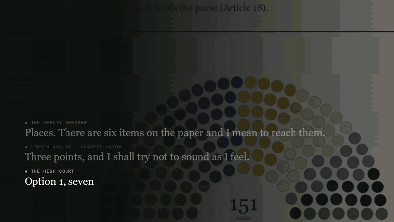
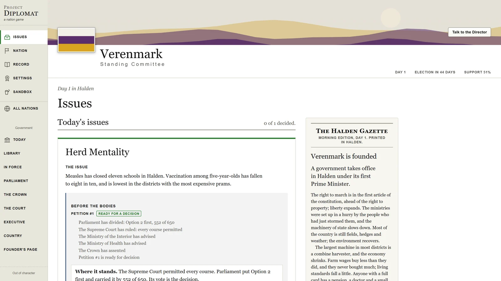
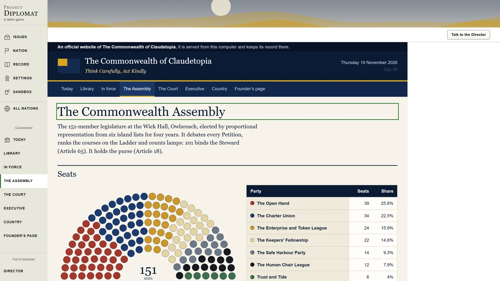
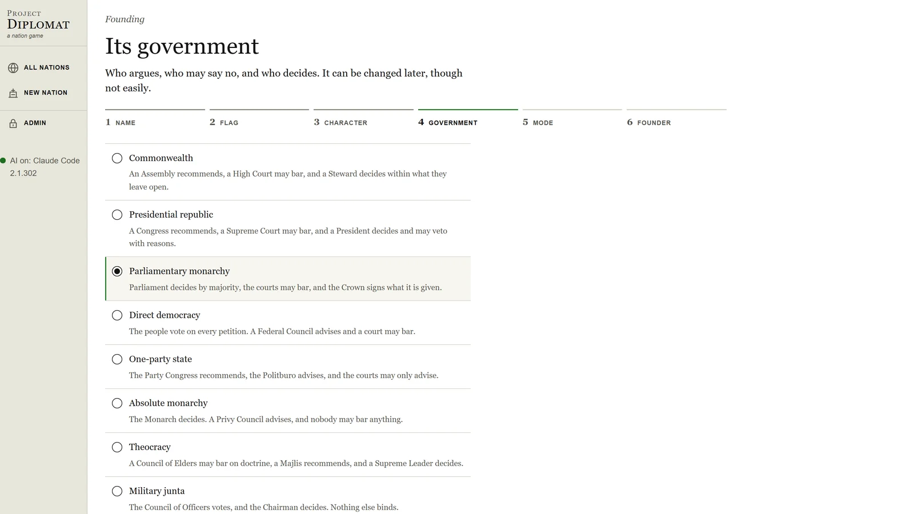
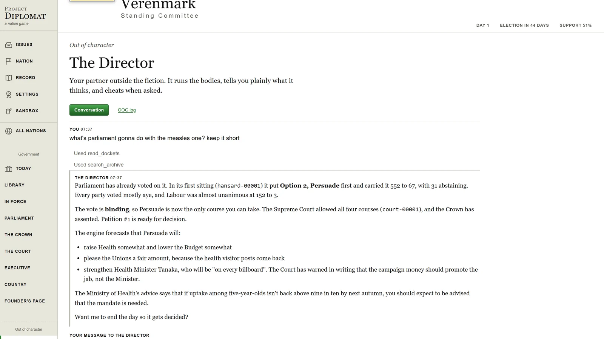
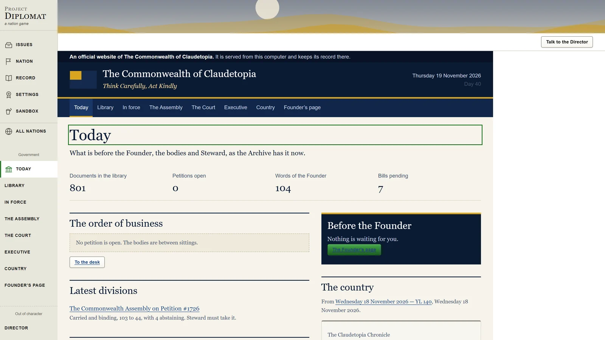

# Project Diplomat

*a nation game. NationStates if it kept going*

you get a policy dilemma, you pick a side, and your country changes because of it. then your
neighbours react, a minister quits, and three weeks later the thing you did about the railways
comes back to bite you

and you don't get to just pick. every issue goes through a government first. parliament argues
and votes, the court can bar what the constitution says no to, the ministries tell you what it'll
cost, and the papers write about it the next morning. you can run that government yourself or
found the country and watch it run itself



and the full trailer if you want it. 52 seconds, sound on

https://github.com/user-attachments/assets/6f4a2c8d-0c76-4958-b395-e0a5ea763289



it's a spiritual successor to [NationStates](https://www.nationstates.net), which i've always
liked and always wished went further. same heart (satirical dilemmas, no right answers, no way to
"win"), just with the stuff i actually wanted in it. it also took over from Claudetopia, my
NationStates nation whose whole government was played by Claude agents. that whole thing lives
in here now, and nothing runs through NationStates anymore

current release is **0.6.1**. [patch notes](CHANGELOG.md) · [terms](TERMS.md) · [privacy](PRIVACY.md) ·
[license](LICENSE-SCOPE.md) · [security](SECURITY.md). "Project Diplomat" is a codename till i settle on a
real name

## what it does

**the government**

- pick how your country is run when you found it: a commonwealth, a presidential republic, a
  parliamentary monarchy, a direct democracy, a one-party state, an absolute monarchy, a
  theocracy or a junta. nobody gets forced into one, and a country can change its form later
  by amendment
- every issue is a petition and it goes before the bodies your constitution has. the
  legislature debates and divides by party, the court rules every option permitted or barred,
  the ministries advise, the crown or the president signs or doesn't
- what they decide actually binds you, the way your form says it does. a barred option is
  barred. a binding vote has to be taken. a veto needs written reasons
- the legislature has real seats and real parties, and an election reseats it



**you, the founder**

- **Govern** means you hold the executive and decide every petition yourself, inside whatever
  the bodies left you
- **Found** means an AI executive governs and you just read the record and step in when you
  feel like it
- either way you sit above every branch. a **Founder's Word** overrules anything, it goes in the
  record word for word, and the bodies are allowed to argue back
- the country writes to you too. questions, letters from regular people, and the occasional
  constable who walked across the island to complain about something



**the director**

- the director is a Claude Code session for each nation that stands outside the story. think of
  it as the friend running the game with you
- it runs the bodies, tells you plainly what it thinks parliament or the court is gonna do and
  what it thinks of your plan, and pushes back when it disagrees
- it also does the sandbox. "set liberty to 90", "skip a week", "call up the measles issue".
  cheats go in a quiet out-of-character log with what you asked for, the nation gets a sandbox
  badge, and every one of them can be undone in one click
- talk to it on the Director page in the game, or run `claude` in this repo and it's right there
  in your terminal with the same tools



**the world and the record**

- after each of your days the world writes one back. weather, events, three newspapers and a
  broadcaster, public opinion, and small effects on the figures inside fixed limits
- every number that moves tells you why. the engine owns all the numbers, the AI never does
- everything goes in an Archive you read as your country's own government website: hansard, court
  reports, the executive's papers, the almanac, bills, letters, factbooks, the constitution.
  nothing in it ever gets changed
- a census in the old NationStates style (population, GDP, tax, crime, life expectancy) worked
  out from the engine, so even those numbers have a reason



**the other stuff**

- the AI is optional. with it off, rules-based stand-ins play every body and the game still
  works. with it on it runs on a Claude API key, or on the Claude Code you've already got
  installed and signed in to
- each body keeps its own Claude Code session, so the court actually remembers its own earlier
  rulings. they're sealed into their own archive and can't read anything outside it
- elections when your form holds them, a crisis now and then, five neighbours, treaties, issues
  that settle who the nation even is (the animal, the motto, the faith), a sandbox and an admin
  page
- the core pack has 120 dilemmas and four crises

not in yet: regional projects, disputes and other players

## run it

you need Node 24 or newer and pnpm

```
pnpm install
pnpm serve     # builds it, then starts it. open the address it prints
```

after the first build `pnpm start` is enough. it runs a small server on your own computer
(127.0.0.1:8150, nothing outside can reach it) and keeps every nation in `data/`, one folder
each, with its save and its Archive as plain Markdown files

`pnpm dev` and `pnpm dev:server` together give you hot reload if you're changing things

### the AI

off by default. turn it on in Settings under AI:

- **Claude API key** is the supported way. the key stays in `data/settings.json` and never gets
  sent to the browser
- **My own Claude Code** uses the `claude` you installed and signed in to yourself. the bodies
  get read-only access to the nation's Archive and nothing else, so parliament and the court read
  their own past sittings. the game never sees or stores your sign-in. see
  [docs/research/04-ai-providers.md](docs/research/04-ai-providers.md) for where that stands
  under Anthropic's terms

the director always uses Claude Code, whichever one the bodies are on

### Claudetopia

```
node scripts/import-claudetopia.ts --source <the Claudetopia archive>
```

brings Claudetopia across from its NationStates years: the constitution and charter, the
Assembly, the High Court and the ministries, and every petition, sitting, opinion, almanac day,
Word and letter. 795 documents the last time i ran it

## other commands

```
pnpm validate                 # check the core pack against the house rules
pnpm simulate                 # one 60-day story with random choices, in the terminal
pnpm simulate 90 42           # 90 days, seed 42
pnpm simulate 135 --runs 200  # averages across 200 seeds, for balance
pnpm test
pnpm typecheck
```

the trailer and the loop up top are made with [Remotion](https://www.remotion.dev) in `motion/`, music
included. the music gets synthesised from scratch in `motion/music.mjs` so there's nothing to license.
run `pnpm install --ignore-workspace` in there, then `pnpm render`

## where things are

```
apps/web             the game: a React app, a client of the server
apps/server          the local server: runs the engine, keeps the saves and the Archive, calls the AI, runs the director
packages/engine      the rules, as pure functions with no dependencies
packages/content     pack schema, loader and validator
packages/government  forms of government, the rules that bind them, the petition pipeline, stand-ins, census
packages/ai          the AI back ends and one prompt per body
packs/core           the dilemmas, factions, policies and traits
scripts              the simulator and the Claudetopia import
motion               the trailer
docs                 the plan, the design notes and the research
```

- [docs/blueprint.md](docs/blueprint.md) is the plan
- [docs/design/nation-model.md](docs/design/nation-model.md) is how a nation works
- [docs/design/government.md](docs/design/government.md) is how its government works, the director included
- [docs/design/writing-dilemmas.md](docs/design/writing-dilemmas.md) is how to write a dilemma
- [docs/design/disputes.md](docs/design/disputes.md) is the conflict system, still only on paper
- [docs/research/](docs/research/) is the reading i did first, including a full teardown of how
  NationStates works and a look at why NationStates 2 failed

## the plan, short version

- single player first. you run it on your own machine and play in the browser. private group
  worlds and a public world come later on the same engine
- the simulation is plain deterministic rules. the AI plays the people in it, it never decides
  the numbers
- dilemmas are data files in packs, so anyone can write them
- no pay to win, ever. nobody can destroy your nation

## contributing

dilemmas are the easiest way in. read [writing-dilemmas.md](docs/design/writing-dilemmas.md), add
a file under `packs/core/dilemmas/` and run `pnpm validate`. what you add to the pack is CC BY-SA 4.0
like the rest of it, and please nothing copied from NationStates. if you've played NationStates
and have opinions about what a successor should do, open an issue

## legal

the code and the technical docs are MIT. the core pack (the dilemmas and everything else in
`packs/core`) is CC BY-SA 4.0, so you can remix it and share it as long as you credit it and keep
the same license. Claudetopia, the trailer, the music and the screenshots are mine and not under
either. it comes with no warranty, and what you send to the AI is between you and Anthropic

- [terms](TERMS.md): the no warranty and liability stuff, and what's on you when the AI is on
- [privacy](PRIVACY.md): what stays on your computer and what goes to Anthropic when
  you switch the AI on
- [notice](NOTICE.md): what the AI is, and why what it writes is fiction
- [license scope](LICENSE-SCOPE.md): which license covers what, and how contributions are licensed
- [copyright](COPYRIGHT.md) and [third-party notices](THIRD-PARTY-NOTICES.md)
- [security](SECURITY.md): what's protected, what isn't, and how to report something privately

not affiliated with NationStates, Max Barry or Anthropic
